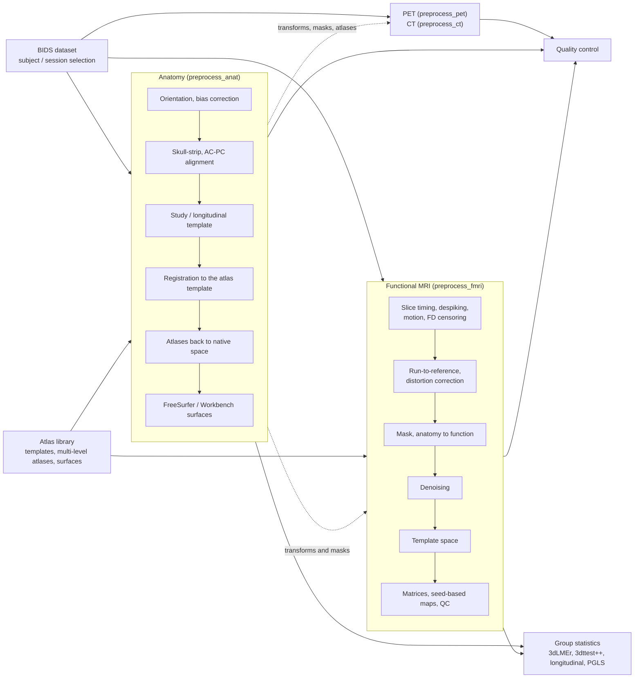

# EDNiX

[](https://github.com/garincle/EDNiX/actions/workflows/tests.yml)

**EDNiX** is a neuroimaging pipeline for **multi-species MRI and PET**: it takes BIDS datasets of rodents, bats, dogs, non-human primates and humans through anatomical, functional and PET preprocessing, brings every subject into a common cross-species atlas framework, and runs group and comparative analyses.

It is developed at the Institut des Sciences Cognitives Marc Jeannerod (CNRS, Lyon).

## Highlights

- **One pipeline, many species.** Species-aware skull-stripping (AFNI, FSL, ANTs, SynthStrip, U-Net models), registration and surface reconstruction, including very small brains (FreeSurfer on rescaled headers).
- **Cross-species atlases.** Multi-level EDNiX atlases (EDNIxCSC, EDNIxCSCLR, 4 levels of detail) and species atlases are projected to every subject, in volume and on the cortical surface.
- **Anatomy.** Orientation fixing for animal positions, bias correction, AC-PC alignment, study or longitudinal templates, FreeSurfer and Connectome Workbench surfaces, cortical thickness and atlas-based regional measures.
- **Functional MRI.** Motion correction with brain-size-scaled censoring, field-map distortion correction, a single interpolation per volume, AFNI / fMRIPrep-style / Grandjean denoising, correlation matrices, seed-based analysis, ICA and dictionary learning.
- **PET (and CT).** Static and dynamic PET with or without MRI or CT (hybrid PET-MR, separate sessions, PET/CT, template only): reorientation as the anatomy, motion correction, registration through the anatomy, SUV and ratio images, regional values and time-activity curves in the PET space, reference-region kinetic models (SRTM, Logan; Turku PET Centre tools), export to the template spaces.
- **Statistics.** Voxel-wise mixed models (3dLMEr) and t-tests with residual-ACF cluster correction, PET group analyses (voxel-wise, regional, surfaces; permutation cluster inference), longitudinal models, phylogenetic regression (PGLS).
- **Provenance.** Every output has a JSON sidecar listing its sources and command; every external command is checked.
- **Interface.** A desktop interface to explore atlases in 3D, edit launchers without code, run and follow pipelines, and review quality control.

## Pipeline overview



## Installation

Short version (details in [docs/installation.md](docs/installation.md)):

```bash
git clone https://github.com/garincle/EDNiX.git
cd EDNiX
pip install -r requirements.txt
```

EDNiX also needs the **Singularity containers** of the neuroimaging programs (AFNI, ANTs, FSL, FreeSurfer, Connectome Workbench, ITK-SNAP; tpcclib for the PET kinetic models) and the **atlas library** (`Atlases_library/`), which are not installed by pip.

## Quick start

1. Copy an example launcher from [`Exemples/Study_EDNiX/Launcher_anat`](Exemples/Study_EDNiX/Launcher_anat) (anatomy) or [`Launcher_func`](Exemples/Study_EDNiX/Launcher_func) (functional MRI).
2. Set `MAIN_PATH` (your EDNiX folder), `bids_dir` (your dataset), `species` and, if needed, the subjects to keep or remove.
3. Run it; `EDNIX_STRICT=1` stops the pipeline at the first failing command:

```bash
EDNIX_STRICT=1 python my_anat_launcher.py
```

Run the anatomical launcher of a dataset before its functional and PET launchers (and the CT launcher before the PET one when the PET goes through a CT): they use the anatomical transforms, masks and atlases. See [docs/launchers.md](docs/launchers.md).

## Graphical interface

```bash
bash GUI/install_shortcut.sh      # once: desktop icon
```

Then double-click the **EDNiX** icon. The interface has four parts:

- **Atlases**: volume and cortical-surface atlases in 3D, several at once (overlaid or side by side), with region search, selections linked across species, and a region-finding challenge.
- **Launchers** (Anatomy, Functional, PET, CT): every launcher parameter as a form field with its description; save and run in the background.
- **Runs**: status, current step and live log of every run.
- **Quality control**: the QC images and tables of a dataset, with outliers highlighted.

To open the interface of a remote server from your computer: `bash GUI/open_remote.sh`. See [GUI/README.md](GUI/README.md).

## Documentation

| Topic | Page |
|---|---|
| Installation, containers, atlas library | [docs/installation.md](docs/installation.md) |
| Writing and running launchers | [docs/launchers.md](docs/launchers.md) |
| BIDS data and subject selection | [docs/bids.md](docs/bids.md) |
| Anatomical pipeline | [docs/anatomical_pipeline.md](docs/anatomical_pipeline.md) |
| Functional pipeline | [docs/functional_pipeline.md](docs/functional_pipeline.md) |
| PET and CT pipelines | [docs/pet_pipeline.md](docs/pet_pipeline.md) |
| Skull-stripping methods and manual masks | [docs/skullstripping.md](docs/skullstripping.md) |
| Atlases and the atlas library | [docs/atlases.md](docs/atlases.md) |
| Group and comparative statistics | [docs/group_analysis.md](docs/group_analysis.md) |
| Quality control | [docs/quality_control.md](docs/quality_control.md) |
| Tests | [docs/testing.md](docs/testing.md) |
| Parameter reference (generated from the code) | [anatomy](docs/reference/anat_parameters.md), [functional](docs/reference/fmri_parameters.md), [PET](docs/reference/pet_parameters.md), [CT](docs/reference/ct_parameters.md) |
| Changes | [CHANGELOG.md](CHANGELOG.md) |

## Repository layout

```
modalities/anat      anatomical pipeline (preprocess_anat)
modalities/fMRI      functional pipeline (preprocess_fmri)
modalities/pet       PET pipeline (preprocess_pet)
modalities/ct        CT pipeline (preprocess_ct), registration of a CT for the PET
atlases/             atlas handling
Statistics/          group statistics (Group_fMRI, Group_PET), phylogenetic analyses (Evo)
Tools/               shared utilities (command runner, BIDS loading, geometry checks)
GUI/                 desktop interface
Exemples/            example launchers and the analyses of the EDNiX study
tests/               unit tests and end-to-end smoke test
docs/                documentation
```

## Status

- The anatomical and functional pipelines are in use on the datasets of the example launchers.
- The PET and CT pipelines (October 2026) are tested on synthetic data for all the scenarios of `pet4.svg` (1v1, 1v2a, 1v2b, 2v1, 2v2, 3v1, 3v2); their first runs on real data must be checked (see [docs/pet_pipeline.md](docs/pet_pipeline.md), section *Limitations*).

## Contributing

Run the tests before submitting a change (`pytest -n auto`, see [docs/testing.md](docs/testing.md)) and add an entry to [CHANGELOG.md](CHANGELOG.md). When you change a pipeline signature or docstring, regenerate the parameter reference with `python docs/generate_parameter_reference.py`.
