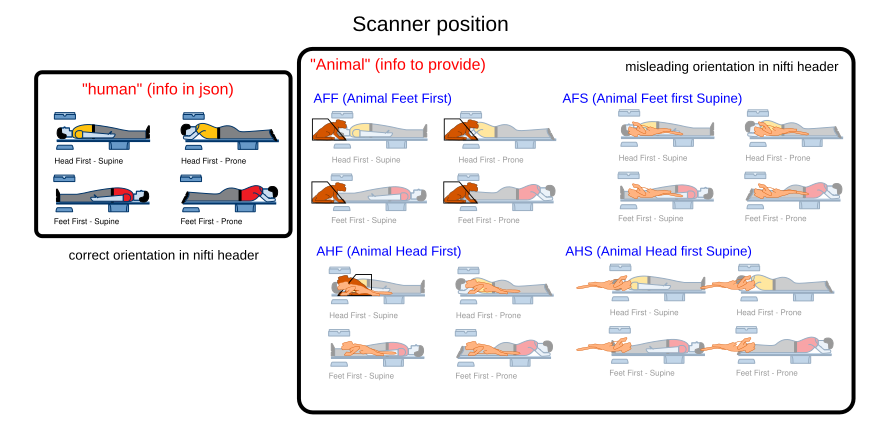
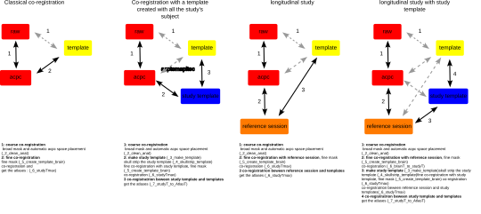

# Anatomical pipeline

Entry point: `modalities/anat/_0_Pipeline_launcher.preprocess_anat`. Every parameter is listed in the [anatomical parameter reference](reference/anat_parameters.md).

## Steps

| step | module | what it does |
|---|---|---|
| `1` | `loop1/_1_correct_orient` | orientation fix (animal position, oblique headers), averaging of repeated scans, bias-field correction (N4 or N3, head mask) |
| `2` | `loop1/_2_clean_anat` | cropping, denoising, AC-PC alignment, first skull-strip, T1w/T2w myelin map when both contrasts exist |
| `itk_1` | | manual check of the first skull-strip in ITK-SNAP |
| `5` | `loop2/_5_create_template_brain` | individual brain template, second skull-strip |
| `itk_2` | | manual check of the second skull-strip |
| `6` | `loop2/_6_stdyTmax` | registration to the study template, the longitudinal reference session or the atlas template |
| `8` | `loop3/backtonative` | atlases and masks brought back to native space |
| `itk_3` | | manual check of the native-space atlases |
| `9`–`11` | `freesurfer/` | fMRI masks, FreeSurfer preparation and input images (small brains rescaled), white surface, inflation, curvature |
| `sphere` | `freesurfer/FS_surf.Wsphere` | spherical registration (`sphere.reg`) and `aparc.annot`. Slow and not needed for the native outputs of EDNiX: only for `doBALSAspace` (fs_LR resampling), the human `fs_extras` parcellations and the `aparc` of the T2w pial refinement. Skipped in the example launchers; can be run later alone (`Skip_step` without `sphere`) |
| `12` | `freesurfer/FS_surf.Pcreate` | pial surface (T2w refinement when available) |
| `flat_map` | `freesurfer/FS_flat` | flat maps |
| `14`–`15` | `connectomeWB/` | atlases projected on the surfaces, FreeSurfer to Workbench conversion |
| `16` | `loop3/_16_anat_QC_SNR`, `Tools/QC_report` | anatomical quality control and surface QC (`anat/QC_anat/<ID>_surface_QC.png`) |
| `Clean` | | deletion of intermediate files |

## Orientation and animal position

Animal data are often acquired in positions that the scanner does not describe (sphinx, supine, head or feet first). EDNiX fixes the orientation from:

- `orientation`: the true orientation code of the images (for example `'LPI'`), applied with `3drefit`;
- or `animalPosition` and `humanPosition`: the scanner labels are converted into anatomical ones geometrically, which always gives a proper rotation (never a left-right mirror).

| `animalPosition` | position of the animal |
|---|---|
| `AHF` | head first, prone (sphinx) |
| `AFF` | feet first, prone |
| `AFS` | head first, supine |
| `AHS` | feet first, supine |
| `humanlike` | as declared to the scanner |

(`AFS` and `AHS` keep their historical meaning for compatibility.) Oblique images are de-obliqued before the orientation fix.

## Registration strategies

- **Classical**: native image to AC-PC space, then to the atlas template.
- **Study template** (`creat_study_template=True`): a template is built from all subjects (`which_on='all'` or the latest session of each subject, `'max'`), skull-stripped (`template_skullstrip`), then registered to the atlas template.
- **Longitudinal** (`coregistration_longitudinal=True`): every session is registered to a reference session of the same subject, itself registered to the template.

The ANTs parameters of each registration (`align`, `between`, `coreg`, `SS1`, `SS2`, `SS3`, `stdyT`) come from `list_transfo` (`load_transfo_parameters.build_transfos`) and `transfo_message` (`'do_it_for_me'`: defaults; `'do_as_I_said'`: your values, completed by defaults).

**`SyNadaptive`** (`coreg` block; experimental, not used by the example launchers): the standard `SyNCC` (Avants et al., 2008) is run, then checked inside the template brain mask (Dice of the brain masks, mean Dice of a 3-class k-means tissue segmentation, fraction of folded voxels of the warp). Only when a check fails, a more compliant SyN (`SyN[0.2,2,0]`, CC radius 4) restricted to the brain masks at every stage (cost-function masking, Brett et al., 2001) refines it from the same affine, and replaces it only if the tissue overlap improves by more than 0.01 without folding. Subjects that pass keep outputs identical to `SyNCC`. The decision and metrics are in `<prefix>_adaptive_QC.json` next to the transforms and in the QC reports. Calibration on BIDS_Park (recon-all aseg as independent labels, `Exemples/Study_EDNiX/analysis/validation/calibrate_synadaptive.py`): in the first 5 subjects the refinement lowered both the label Dice (−0.005 to −0.043) and the tissue Dice, so the gate never selects it and `SyNCC` stays the default; blocks that inherit from `coreg` (`SS1`–`SS3`, `stdyT`) use `SyNCC`.

**`tissue_relabel`** (`coreg` block option, `'tissue_relabel': True`; off by default, enabled in the Human and Macaque example launchers; it degraded Rat and Marmoset in tests, where GM/WM contrast is too low): at step 8, after the template seg-4FS is warped to the subject, the cortex / cerebral WM / sulcal CSF of the cortical ribbon are re-decided by a 3-class Gaussian mixture of the subject's own intensities (T1w and T2w jointly when both exist on the same grid, full covariance), with the warped labels as spatial prior (unified segmentation, Ashburner & Friston, 2005; Atropos with priors, Avants et al., 2011). Hemisphere and subcortical labels are kept. Distances are scaled by the subject's cortical thickness estimated from the warped cortex label, so the rule is the same from mouse to human; if GM and WM are not separable in the data (Fisher distance < 1) the registration labels are kept. Lateral ventricles may grow into CSF by at most 1.33 cortical thicknesses, away from the cortex. The registration-only seg, a JSON report (separation, thickness, volume changes, WM connectivity, GM/WM boundary gradient) and a QC figure are written to `labels/tissue_relabel/` and `QC/tissue_relabel/`. Calibration on BIDS_Park (n = 5, recon-all aseg as reference, `validation/calibrate_registration_variants.py`): mean label Dice +0.025 in 5/5 subjects (cortex ≈ 0.58 → 0.76, cerebral WM ≈ 0.75 → 0.85); multichannel SyN and SyN refinement did not help. Not yet validated against manual labels nor in non-human species (`validation/test_tissue_relabel_species.py`); recon-all uses T1 intensities too, so part of the agreement is shared information.

## Surfaces

FreeSurfer is run on the skull-stripped brain. Brains smaller than about 10 cm³ (rodents, bats, mouse lemur, marmoset) are enlarged in the header before FreeSurfer and the results are brought back to the real size: surfaces through the registration file, thickness, sulcal depth and curvature by the same scale factor. FreeSurfer does not segment the image itself: its inputs are built from the subject's seg-4FS (surface method `V2h`, `preFS.SURFACE_METHOD`, chosen in November 2026 from surface tests on 5 library templates and 10 BIDS subjects). `brain.mgz` is synthetic with non-overlapping class intensities (CSF 10–35 and GM 55–85, each keeping the within-class texture of the image; WM 110; Gaussian smoothing of 0.5 voxel), `wm.mgz` is WM 110 and subcortical nuclei 250, and hippocampus/amygdala stay in the GM class and out of `wm.mgz`/`filled.mgz` (putting them in the WM produced one-sided temporal pial loops). The pial search distance of `mris_make_surfaces` is capped at 3 real mm (`-max` = max(5, ⌈3 / real mm per FreeSurfer mm⌉)): with the default 5 FreeSurfer mm, the cap after the small-brain rescaling was 0.9–1.4 real mm in rodents and truncated their cortex. `SURFACE_METHOD = 'legacy'` restores the EDNiX v1 behaviour (overlapping class ranges, default cap). Without the `sphere` step, steps 14–15 skip the fs_LR / BALSA resampling and the human `fs_extras` parcellations (with a warning). The surfaces are then converted to Connectome Workbench (`native/surfaces/Native_resol`, `fsaverage_LR_32k`) with the atlas labels projected on them.

## Main outputs

- `anat/native/volumes/`: AC-PC images, brain masks, tissue masks, atlases in native space (`labels/`).
- `anat/templates/<reference>/`: images and atlases in template space.
- `anat/native/surfaces/`: white, pial, midthickness and inflated surfaces, thickness, curvature, sulcal depth, label files.
- `anat/matrices/`: every transform, for reuse by the functional pipeline.

Skull-stripping options are described in [skullstripping.md](skullstripping.md), atlases in [atlases.md](atlases.md).
