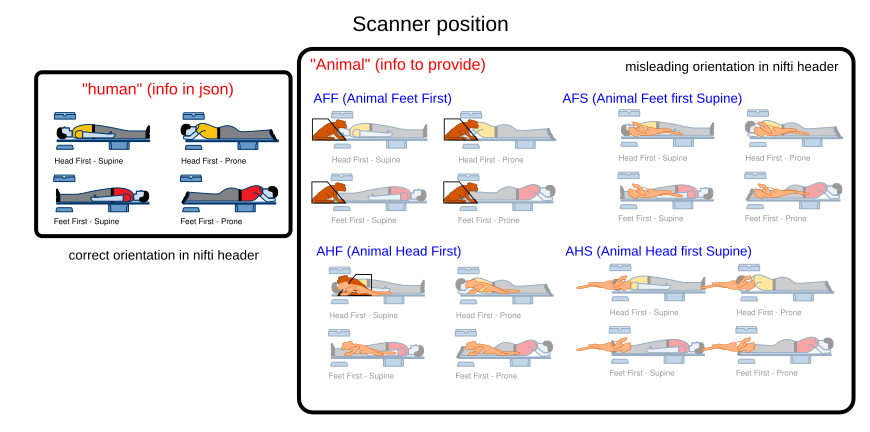
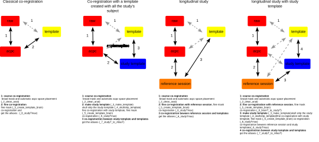

# Anatomical pipeline

Entry point: `modalities/anat/_0_Pipeline_launcher.preprocess_anat`. Every parameter is listed in the [anatomical parameter reference](reference/anat_parameters.md).

## Steps

| step | module | what it does |
|---|---|---|
| `1` | `loop1/_1_correct_orient` | orientation fix (animal position, oblique headers), averaging of repeated scans, bias-field correction (N4 or N3, head mask) |
| `2` | `loop1/_2_clean_anat` | cropping, denoising, AC-PC alignment, first skull-strip, T1w/T2w myelin map when both contrasts exist |
| `itk_1` | | manual check of the first skull-strip in ITK-SNAP |
| `5` | `loop2/_5_create_template_brain` | individual brain template, second skull-strip |
| `itk_2` | | manual check of the second skull-strip |
| `6` | `loop2/_6_stdyTmax` | registration to the study template, the longitudinal reference session or the atlas template |
| `8` | `loop3/backtonative` | atlases and masks brought back to native space |
| `itk_3` | | manual check of the native-space atlases |
| `9`–`12` | `freesurfer/` | FreeSurfer preparation, input images (small brains rescaled), white and pial surfaces |
| `flat_map` | `freesurfer/FS_flat` | flat maps |
| `14`–`15` | `connectomeWB/` | atlases projected on the surfaces, FreeSurfer to Workbench conversion |
| `16` | `loop3/_16_anat_QC_SNR` | anatomical quality control |
| `Clean` | | deletion of intermediate files |

## Orientation and animal position

Animal data are often acquired in positions that the scanner does not describe (sphinx, supine, head or feet first). EDNiX fixes the orientation from:

- `orientation`: the true orientation code of the images (for example `'LPI'`), applied with `3drefit`;
- or `animalPosition` and `humanPosition`: the scanner labels are converted into anatomical ones geometrically, which always gives a proper rotation (never a left-right mirror).

| `animalPosition` | position of the animal |
|---|---|
| `AHF` | head first, prone (sphinx) |
| `AFF` | feet first, prone |
| `AFS` | head first, supine |
| `AHS` | feet first, supine |
| `humanlike` | as declared to the scanner |

(`AFS` and `AHS` keep their historical meaning for compatibility.) Oblique images are de-obliqued before the orientation fix.

## Registration strategies

- **Classical**: native image to AC-PC space, then to the atlas template.
- **Study template** (`creat_study_template=True`): a template is built from all subjects (`which_on='all'` or the latest session of each subject, `'max'`), skull-stripped (`template_skullstrip`), then registered to the atlas template.
- **Longitudinal** (`coregistration_longitudinal=True`): every session is registered to a reference session of the same subject, itself registered to the template.

The ANTs parameters of each registration (`align`, `between`, `coreg`, `SS1`, `SS2`, `SS3`, `stdyT`) come from `list_transfo` (`load_transfo_parameters.build_transfos`) and `transfo_message` (`'do_it_for_me'`: defaults; `'do_as_I_said'`: your values, completed by defaults).

## Surfaces

FreeSurfer is run on the skull-stripped brain. Brains smaller than about 10 cm³ (rodents, bats, mouse lemur, marmoset) are enlarged in the header before FreeSurfer and the results are brought back to the real size: surfaces through the registration file, thickness, sulcal depth and curvature by the same scale factor. The surfaces are then converted to Connectome Workbench (`native/surfaces/Native_resol`, `fsaverage_LR_32k`) with the atlas labels projected on them.

## Main outputs

- `anat/native/volumes/`: AC-PC images, brain masks, tissue masks, atlases in native space (`labels/`).
- `anat/templates/<reference>/`: images and atlases in template space.
- `anat/native/surfaces/`: white, pial, midthickness and inflated surfaces, thickness, curvature, sulcal depth, label files.
- `anat/matrices/`: every transform, for reuse by the functional pipeline.

Skull-stripping options are described in [skullstripping.md](skullstripping.md), atlases in [atlases.md](atlases.md).
